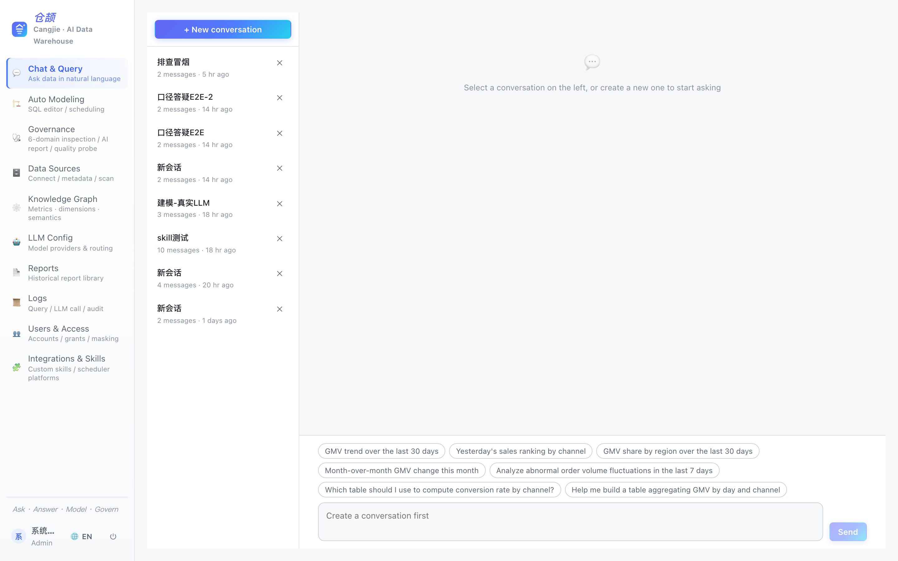
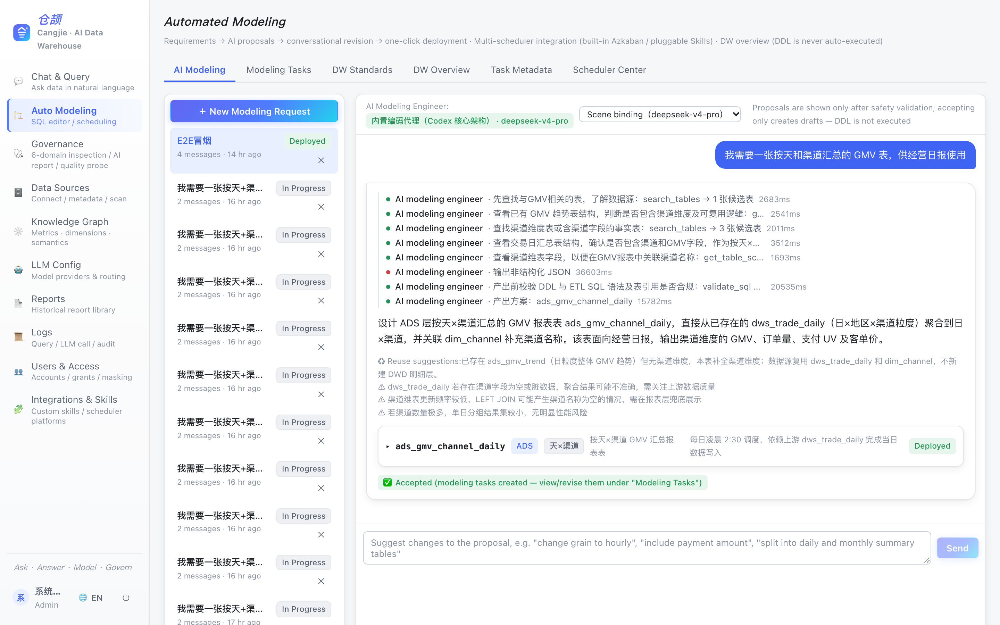
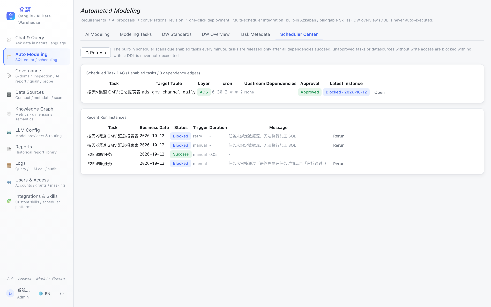
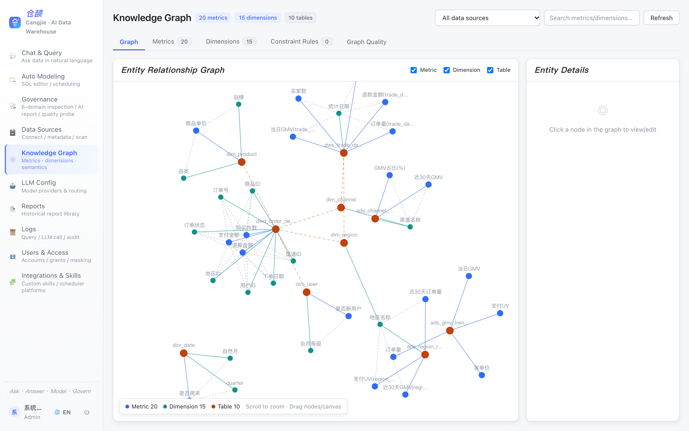
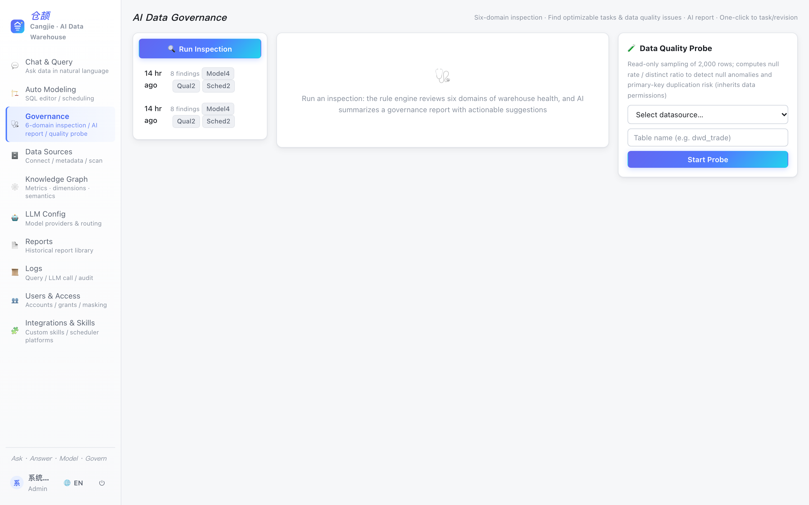
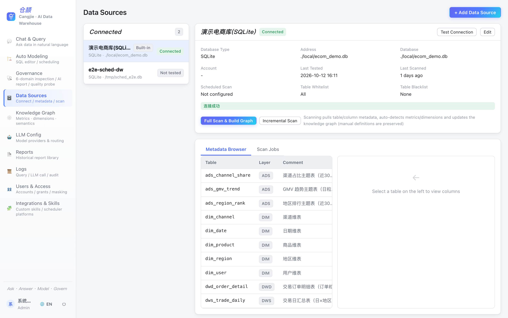

# 仓颉 Cangjie DataHub · AI Data Warehouse Workbench

**English** | [简体中文](README.zh-CN.md)

<p>
  
  
  
  
</p>

> **Cangjie DataHub** is an open-source, AI-native data warehouse workbench:
> ask your warehouse questions in natural language, let a built-in coding agent design
> and schedule ETL models, and keep data quality, semantics and governance under one roof —
> with an enterprise-grade security perimeter around every AI capability.

Named after **Cangjie (仓颉)**, the legendary inventor of Chinese characters — the one who gave data its language.

---

## ✨ Why Cangjie DataHub?

Most "chat-with-data" tools stop at generating a SQL string. Cangjie goes all the way from **question → governed SQL → result & chart → ETL pipeline → scheduled production job → governance loop**, while treating safety as a first-class citizen:

- 🤖 **AI-native, not AI-bolted-on** — a four-layer agent foundation (intent routing → skill pipeline → knowledge graph → guarded execution) powers every module, and each scene can be bound to its own LLM.
- 🛡 **Security by architecture** — AST-level SQL guard (SELECT-only), credential encryption (AES-256-GCM), sandboxed custom skills, dual human gates before any scheduled write, login rate limiting, full audit trail.
- 🏗 **From chat to production** — the built-in modeling coding agent designs star-schema tasks, derives dependencies automatically, and ships them to the built-in scheduler, Azkaban or Airflow.
- 🔌 **Bring your own warehouse** — MySQL, PostgreSQL, ClickHouse, Hive, Spark SQL, Doris, StarRocks, SQLite.
- 🌐 **Bilingual UI** — English & Chinese, one-click switch.
- 🐳 **One command to run** — `docker compose up`, demo data included.

---

## 📸 Screenshots

| Ask in natural language — steps, SQL, pie chart | Trend analysis with anomaly detection |
| --- | --- |
|  |  |

| Chat & Query | Auto Modeling (AI Agent) |
| --- | --- |
|  |  |

| Built-in Scheduler (DAG) | Knowledge Graph |
| --- | --- |
|  |  |

| Data Governance | Data Sources |
| --- | --- |
|  |  |

More screenshots: [English](docs/screenshots/en/) · [中文截图](docs/screenshots/zh/)

---

## 🧩 Module Guide

### 1. Chat & Query (对话问答)
Ask questions in plain language; get governed SQL, results, charts and an auditable reasoning trail.

- **Intent routing** — LLM classifies each question: metric Q&A / table & metric explanation / ETL request / custom skill / general chat. Custom skills match by trigger keywords first, safety intercepts always win.
- **SQL generation pipeline** — question rewriting → candidate table recall (metadata + knowledge graph + vector search via Qdrant) → SQL generation → **sqlglot AST guard** (single SELECT only, table whitelist & permission check, cross-database qualifier rejection, dangerous function blacklist, string-literal-aware keyword scan, forced LIMIT) → dialect transpilation → execution with session-level read-only + timeout.
- **Live reasoning** — every step streams over SSE (rewrite → recall → generate → guard → execute → chart), and can be cancelled mid-flight.
- **Metric clarification** — ambiguous metric names trigger a candidate picker instead of a blind guess.
- **Smart charts** — result shape drives chart type (line/bar/pie/table), rendered with ECharts.
- **Query cache** — identical question + schema fingerprint hits TTL cache with hit counting.
- **Analysis reports** — one click turns an answer into a persistent markdown report with charts.

### 2. Knowledge Graph (知识图谱)
The semantic brain of the platform.

- **Auto-built** from metadata scans: tables, columns, metrics, dimensions, sample-value profiling (distinct ratio → metric vs dimension classification).
- **Human-curated semantics** — register business definitions, formulas, units, grains, aliases; human edits survive re-scans.
- **Visual exploration** — force-directed canvas (HiDPI-aware) with lineage edges between tables, metrics and dimensions.
- **Validation rules** — built-in & custom rules (e.g. metric must have formula, dimension must map to columns), block/warn severities.

### 3. AI Auto-Modeling (自动化建模)
A built-in **coding agent** (agentic loop: reason → tool call → observe → repeat, max 8 steps) designs warehouse models from requirements.

- **Whitelisted read-only tools** — search_tables / get_table_schema / list_layer_tables / get_existing_tasks / validate_sql / get_dw_standards. No shell, no network, no file writes; the only "write" is the proposal text.
- **Multi-round refinement** — converse with the agent; every assistant proposal is re-validated (dangerous-statement stripping, sqlglot check, DW-standards rules) before it can be applied.
- **Per-session model choice** — bind any configured chat model to a modeling session.
- **One-click materialization** — proposals become ETL tasks; **dependencies are auto-derived** by matching source tables to upstream tasks' target tables (cycle-checked via DFS).
- **Versioned tasks** — every save snapshots DDL/ETL SQL for rollback.

### 4. Scheduling Platform (调度平台)
Three ways to run your jobs — pick one or mix:

| Mode | How it works |
| --- | --- |
| **Built-in scheduler** | Azkaban-inspired engine: cron triggers, task-level `depends_on` DAG, business date `${ds}` (T-1), run instances (waiting/running/success/failed/blocked), catch-up window, manual trigger & retry, DAG overview. |
| **Azkaban** | Flow 2.0 project zip generated (DDL included as attachment only, never auto-executed) and pushed after explicit human confirmation; full metadata read-back (projects/flows/schedules/executions). |
| **Airflow** | Read-only REST integration (DAG list + latest runs) + built-in DAG `.py` template export — you drop the file into `dags/`. |
| **Other platforms** | Upload a **scheduler skill** (sandboxed, network-free) implementing `build_package(task)` to generate importable project files. |

**Dual gates for scheduled writes** — a task's ETL SQL only runs when ① an admin approves the task **and** ② the datasource has "allow scheduled writes" enabled. Otherwise the run instance stays `blocked` with zero write actions. DDL is **never** auto-executed, anywhere.

### 5. Data Governance (数据治理)
- **Six-domain inspection** — metadata, model, scheduling, data quality, security, cost; deterministic rule engine finds waste and risk.
- **AI governance report** — findings summarized by LLM into actionable recommendations.
- **Read-only quality probes** — null-rate/distinct/sample checks that inherit your data permissions.
- **Finding → action** — one click converts a finding into a modeling task or an AI revision request.

### 6. Data Sources (数据源管理)
8 connector types (MySQL / PostgreSQL / ClickHouse / Hive / Spark / Doris / StarRocks / SQLite) with:
- Connection testing, scheduled & manual metadata scans (batch + failure logs), table white/blacklists.
- **Per-datasource security switches** — enforced read-only session (default on), allow scheduled writes (default off), TLS verification for remote platforms.
- Column-level **masking rules** (partial/hash/null) with wildcard patterns.
- Credentials are AES-256-GCM encrypted and never returned to the frontend.

### 7. LLM Configuration (LLM 配置)
- OpenAI / Anthropic compatible providers; multiple configs per provider.
- **Scene routing** — chat / modeling agent / ETL assistant / governance… each scene binds its own model; sessions can override.
- Call observability: latency, token usage, error rate per config & scene.

### 8. Custom Skills (自定义 Skill)
Extend the platform with zip-packaged skills:
- **Prompt skills** — markdown prompt templates routed through the LLM gateway.
- **Python skills** — run in a subprocess sandbox (no network, no disk writes, CPU/memory/time limits) with a restricted ctx API (read-only metadata, KG queries, guarded SQL).
- Static blacklist scan on upload (`os.system`, `subprocess`, `socket`, `urllib`, `importlib`…); admin-only upload; every invocation audited.

### 9. Users, Permissions & Audit (用户与权限)
- Three roles: **admin / analyst / viewer**; per-user datasource grants; last-active-admin protection.
- **Login rate limiting** — 5 consecutive failures lock the account for 10 minutes.
- Full audit trail (logins & failures, config changes, pushes, approvals, deletions) + query records + LLM call logs with pagination & filters.

### 10. DW Standards (数仓规范)
Codify your warehouse conventions (layer-prefix naming, partition & comment requirements, no reverse-layer references…) as machine-checkable rules; the modeling agent reads them as context and every proposal is validated against them. Import/export as Markdown.

---

## 🏛 Architecture

```
┌─────────────────────────── React 18 + Vite (bilingual UI) ───────────────────────────┐
│  Chat · Modeling · Scheduler · Governance · KG · Datasources · LLM · Logs · Users    │
└────────────────────────────────── SSE / REST ─────────────────────────────────────────┘
┌─────────────────────────── FastAPI (async) ───────────────────────────────────────────┐
│  Intent router → Skill pipeline (rewrite/recall/sql_gen/sql_guard/chart/report)      │
│  Coding agent (tool whitelist, step budget, SSE steps)                                │
│  Scheduler engine (cron slots, dep gating, dual write gates)                          │
│  Auth (JWT + argon2 + rate limit) · RBAC · Audit · AES-256-GCM vault                  │
├───────────────┬───────────────────┬─────────────────────┬─────────────────────────────┤
│ SQLAlchemy    │ Qdrant (vectors)  │ LLM gateway         │ Connectors: MySQL / PG /    │
│ (SQLite/PG)   │ (optional)        │ (OpenAI/Anthropic)  │ ClickHouse / Hive / Spark / │
│               │                   │                     │ Doris / StarRocks / SQLite  │
└───────────────┴───────────────────┴─────────────────────┴─────────────────────────────┘
```

**Security perimeter** (enforced server-side, not by prompt):
SELECT-only AST guard · cross-DB qualifier rejection · forced LIMIT · session read-only + timeout ·
sandboxed skills (no net/disk) · DDL never auto-executed · dual human gates for scheduled writes ·
encrypted credentials · login lockout · LIKE-wildcard escaping · full audit.

---

## 🚀 Quick Start

### Docker (recommended)

```bash
git clone https://github.com/brothers7/cangjie-datahub.git
cd cangjie-datahub
make up          # first run copies .env.example → .env; CHANGE THE SECRETS inside
```

- Frontend: http://localhost:8080  (default account `admin / admin12345`)
- Backend API docs: http://localhost:9000/docs
- A demo e-commerce warehouse (SQLite) is bundled so every feature works out of the box.

### Local development

```bash
# Backend (Python 3.11+)
cd backend && python -m venv .venv && source .venv/bin/activate
pip install -r requirements.txt
uvicorn app.main:app --port 9111

# Frontend (Node 18+)
cd frontend && npm install
VITE_DEV_API=http://127.0.0.1:9111 npm run dev    # http://localhost:5173
```

### Configure your LLM
Log in as admin → **LLM Config** → add an OpenAI or Anthropic compatible endpoint (API keys are stored AES-256-GCM encrypted) → bind models to scenes → start asking.

---

## 🧪 Tests & Quality

```bash
cd backend && .venv/bin/python -m pytest tests/     # 234 tests
cd frontend && npx tsc --noEmit && npm run build
```

---

## 🗺 Roadmap

- [ ] More warehouses (Trino/Presto, BigQuery, Snowflake)
- [ ] Scheduler skill marketplace samples (DolphinScheduler, Airflow REST v2)
- [ ] Row-level security policies
- [ ] SSO / OIDC login

---

## 🤝 Contributing

Issues and PRs are welcome! Please read the module guide above and keep the security perimeter intact (see `prd.md` for the full product spec, Chinese).

## 💼 Business Cooperation / 商务合作

For enterprise support, custom development, or on-premise deployment:

- **QQ**: 763342138
- **Email**: 763342138@qq.com

## 📄 License

[MIT](LICENSE) © 2026 Cangjie DataHub Contributors
