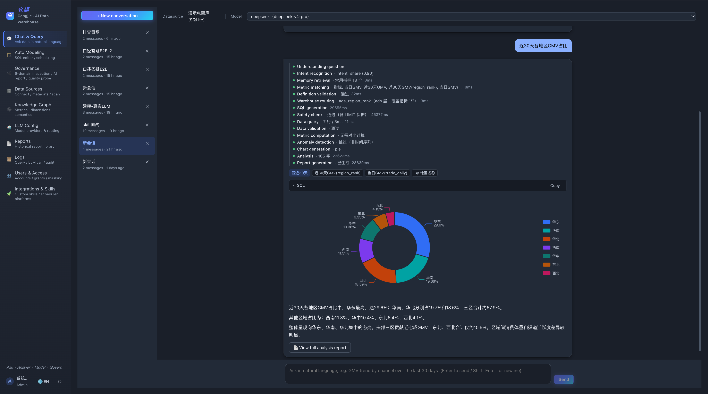
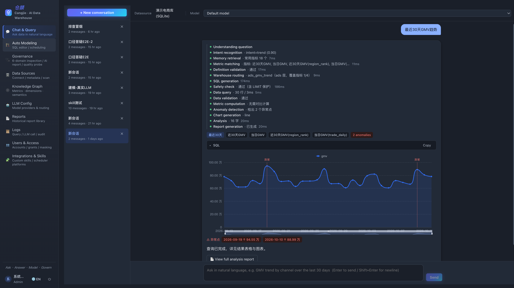
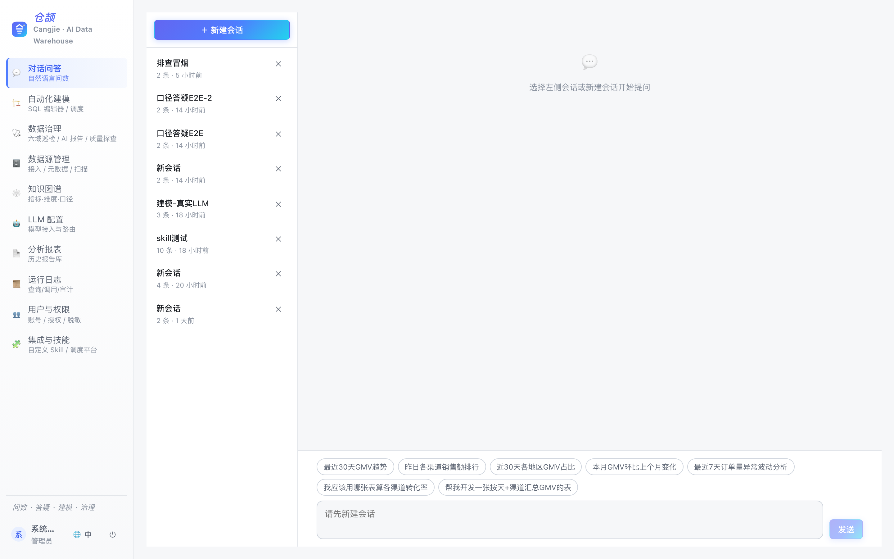
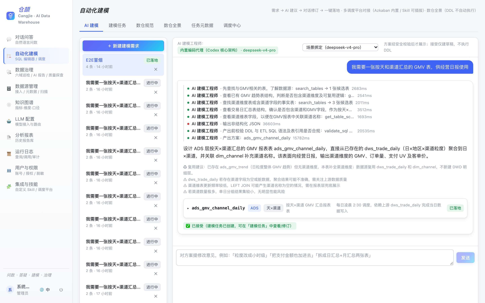
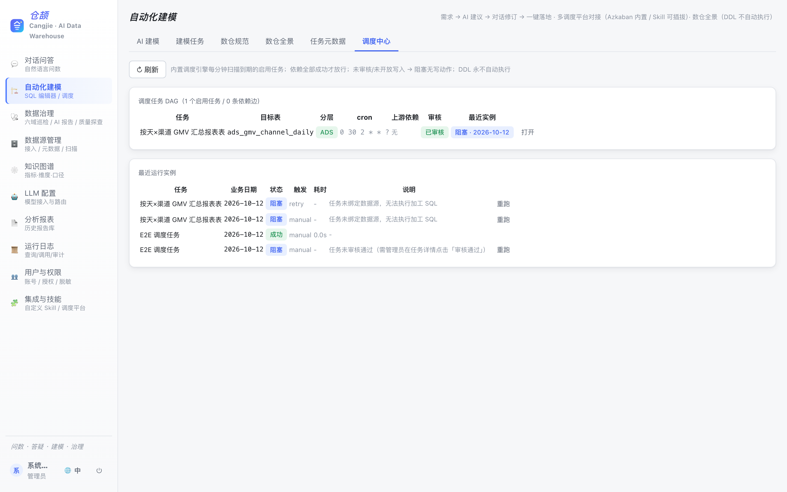
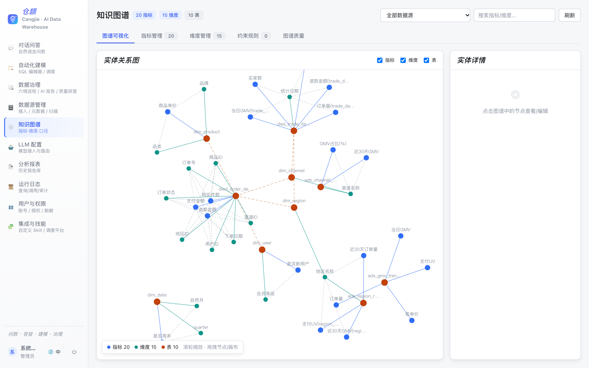
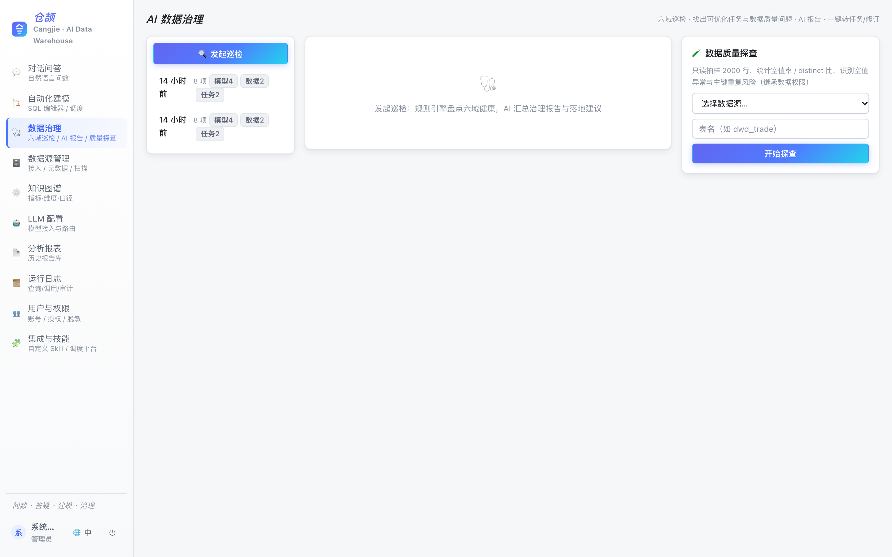
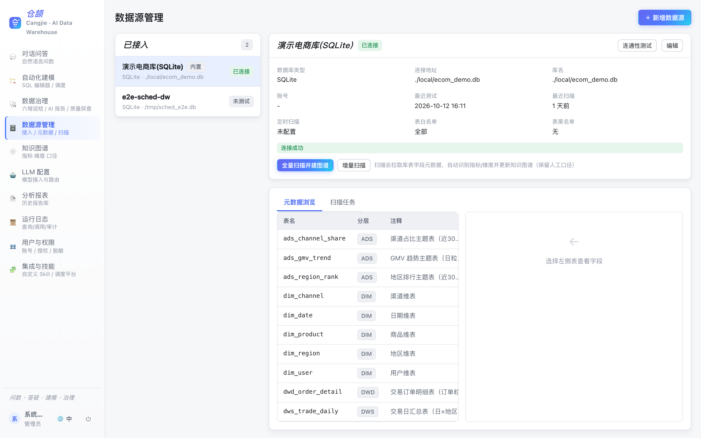

# 仓颉 Cangjie DataHub · AI 数仓工作台

[English](README.md) | **简体中文**

<p>
  
  
  
  
</p>

> **仓颉 DataHub** 是一个开源的 AI 原生数仓工作台：
> 用自然语言向数仓提问，让内置编码代理帮你设计并调度 ETL 模型，
> 数据质量、口径语义与数据治理一站式完成——每一项 AI 能力都包裹在企业级安全边界之内。

以传说中创造汉字的 **仓颉** 命名——他赋予了数据语言。

---

## ✨ 为什么是仓颉 DataHub？

大多数"对话式查数"工具止步于生成一段 SQL。仓颉打通了 **提问 → 受控 SQL → 结果与图表 → ETL 管线 → 生产调度 → 治理闭环** 的完整链路，并把安全作为一等公民：

- 🤖 **AI 原生，而非外挂**——四层智能体底座（意图路由 → Skill 管线 → 知识图谱 → 受控执行）驱动每个模块，每个场景可独立绑定模型。
- 🛡 **架构级安全**——AST 级 SQL 守卫（仅 SELECT）、凭证 AES-256-GCM 加密、自定义 Skill 沙箱、调度写双重人工闸门、登录限流、全链路审计。
- 🏗 **从对话到生产**——内置建模编码代理设计维度建模任务，自动推导任务依赖，一键送达内置调度引擎 / Azkaban / Airflow。
- 🔌 **接入你的数仓**——MySQL、PostgreSQL、ClickHouse、Hive、Spark SQL、Doris、StarRocks、SQLite。
- 🌐 **双语界面**——中/英文一键切换。
- 🐳 **一条命令起飞**——`docker compose up`，内置演示数据。

---

## 📸 界面截图

| 自然语言提问——过程、SQL、占比图一目了然 | 趋势分析 + 异常点自动检出 |
| --- | --- |
|  |  |

| 对话问答 | AI 自动化建模 |
| --- | --- |
|  |  |

| 内置调度（DAG） | 知识图谱 |
| --- | --- |
|  |  |

| 数据治理 | 数据源管理 |
| --- | --- |
|  |  |

更多截图：[中文](docs/screenshots/zh/) · [English](docs/screenshots/en/)

---

## 🧩 模块详解

### 1. 对话问答
用自然语言提问，获得经过安全校验的 SQL、结果、图表与可审计的推理过程。

- **意图路由**——LLM 对每个问题分类：指标问数 / 库表与指标答疑 / ETL 需求 / 自定义 Skill / 通用对话。自定义 Skill 先按触发词匹配，安全拦截永远优先。
- **SQL 生成管线**——问题改写 → 候选表召回（元数据 + 知识图谱 + Qdrant 向量检索）→ SQL 生成 → **sqlglot AST 守卫**（仅单条 SELECT、表白名单与权限校验、跨库限定名拒绝、危险函数黑名单、字符串字面量感知的关键词扫描、强制 LIMIT）→ 方言转译 → 会话级只读 + 超时控制下执行。
- **过程实时可见**——每个步骤经 SSE 流式推送（改写 → 召回 → 生成 → 守卫 → 执行 → 图表），可随时中断。
- **指标消歧**——指标名歧义时弹出候选卡片让用户确认，而不是盲目猜测。
- **智能图表**——按结果形态自动选择图型（折线/柱状/饼图/表格），ECharts 渲染。
- **查询缓存**——相同问题 + 相同 Schema 指纹命中 TTL 缓存并计数。
- **分析报表**——一键把答案沉淀为带图表的 Markdown 报告，进入报告库。

### 2. 知识图谱
平台的语义大脑。

- **自动构建**——元数据扫描自动生成表、字段、指标、维度节点，采样值画像（distinct 比率）辅助区分指标与维度。
- **人工口径登记**——业务定义、计算公式、单位、粒度、别名；人工编辑在重扫后保留。
- **可视化探索**——力导向画布（高分屏适配），表/指标/维度之间的血缘边清晰可见。
- **校验规则**——内置与自定义规则（如指标必须有公式、维度必须映射字段），支持阻断/告警两级。

### 3. AI 自动化建模
内置**编码代理**（代理循环：推理 → 工具调用 → 观察 → 循环，最多 8 步）把需求变成维度模型。

- **白名单只读工具**——search_tables / get_table_schema / list_layer_tables / get_existing_tasks / validate_sql / get_dw_standards。无 shell、无网络、无文件写；唯一的"写"是产出方案文本。
- **多轮修订**——与代理对话迭代方案；每版方案都经过二次校验（危险语句剔除、sqlglot 校验、数仓规范检查）后才允许应用。
- **会话级模型选择**——每个建模会话可绑定任意已配置的对话模型。
- **一键落地**——方案转为 ETL 任务；**依赖自动推导**：按来源表匹配上游任务的目标表（DFS 环检测）。
- **版本留档**——每次保存快照 DDL/加工 SQL，可回滚。

### 4. 调度平台
三种运行方式，可混用：

| 模式 | 工作方式 |
| --- | --- |
| **内置调度引擎** | 参考 Azkaban 概念：cron 定时、任务级 depends_on DAG、业务日期 `${ds}`（T-1）、运行实例（等待/运行中/成功/失败/阻塞）、补偿窗口、手动触发与重跑、DAG 总览。 |
| **Azkaban** | 生成 Flow 2.0 工程 zip（DDL 仅作附件，绝不自动执行），人工二次确认后推送；完整元数据回读（项目/flow/调度/执行历史）。 |
| **Airflow** | REST 只读对接（DAG 列表 + 最近运行）+ 内置 DAG `.py` 模板导出，人工放入 dags 目录生效。 |
| **其他平台** | 上传**调度 Skill**（沙箱禁网），实现 `build_package(task)` 契约生成可导入的工程文件。 |

**调度写双重闸门**——任务的加工 SQL 只有在 ① 管理员审核通过 且 ② 数据源开启"允许内置调度写入" 时才会执行；否则运行实例保持阻塞，零写动作。DDL 在任何地方都**绝不自动执行**。

### 5. 数据治理
- **六域巡检**——元数据、模型、调度、数据质量、安全、成本；确定性规则引擎发现浪费与风险。
- **AI 治理报告**——LLM 把巡检发现总结为可执行建议。
- **只读质量探查**——空值率/去重/样例检查，继承用户数据权限。
- **发现即行动**——治理项一键转建模任务或 AI 修订。

### 6. 数据源管理
8 种连接器（MySQL / PostgreSQL / ClickHouse / Hive / Spark / Doris / StarRocks / SQLite）：
- 连通性测试、定时/手动元数据扫描（批量 + 失败日志）、表白/黑名单。
- **数据源级安全开关**——强制只读会话（默认开）、允许内置调度写入（默认关）、远端平台 TLS 证书校验。
- 字段级**脱敏规则**（部分打码/哈希/置空），支持通配符模式。
- 凭证 AES-256-GCM 加密存储，前端永不回显。

### 7. LLM 配置
- OpenAI / Anthropic 兼容协议，每家可配多个接入。
- **场景路由**——问答 / 建模代理 / ETL 助手 / 治理…每个场景独立绑模型，会话可覆盖。
- 调用观测：按配置与场景统计时延、Token 用量、错误率。

### 8. 自定义 Skill
zip 包扩展平台能力：
- **提示词型**——Markdown 提示词模板，走 LLM 网关。
- **Python 型**——子进程沙箱执行（禁网、禁写盘、CPU/内存/超时限制），受限 ctx API（只读元数据、KG 查询、受控 SQL）。
- 上传静态黑名单扫描（`os.system`/`subprocess`/`socket`/`urllib`/`importlib`…）；仅管理员可上传；每次调用留审计。

### 9. 用户、权限与审计
- 三种角色：**管理员 / 分析师 / 只读用户**；按用户授权数据源；最后一名管理员保护。
- **登录限流**——连续 5 次失败锁定 10 分钟。
- 全链路审计（登录与失败、配置变更、推送、审核、删除）+ 查询记录 + LLM 调用日志，支持分页与筛选。

### 10. 数仓规范
把数仓约定（分层前缀命名、分区与注释要求、禁止反向跨层引用…）固化为机器可校验的规则；建模代理将其作为上下文遵守，所有产出逐条过检。支持 Markdown 导入导出。

---

## 🏛 技术架构

```
┌─────────────────────────── React 18 + Vite（双语界面）───────────────────────────────┐
│  问答 · 建模 · 调度 · 治理 · 图谱 · 数据源 · LLM · 日志 · 用户                        │
└────────────────────────────────── SSE / REST ─────────────────────────────────────────┘
┌─────────────────────────── FastAPI（全异步）──────────────────────────────────────────┐
│  意图路由 → Skill 管线（改写/召回/SQL生成/SQL守卫/图表/报表）                          │
│  编码代理（工具白名单、步数上限、SSE 步骤）                                            │
│  调度引擎（cron 槽位、依赖闸门、写双闸门）                                             │
│  认证（JWT + argon2 + 限流）· RBAC · 审计 · AES-256-GCM 密钥库                        │
├───────────────┬───────────────────┬─────────────────────┬─────────────────────────────┤
│ SQLAlchemy    │ Qdrant（向量，    │ LLM 网关            │ 连接器：MySQL / PG /        │
│（SQLite/PG）  │  可选）           │（OpenAI/Anthropic） │ ClickHouse / Hive / Spark / │
│               │                   │                     │ Doris / StarRocks / SQLite  │
└───────────────┴───────────────────┴─────────────────────┴─────────────────────────────┘
```

**安全边界**（服务端强制，不靠提示词）：
仅 SELECT 的 AST 守卫 · 跨库限定名拒绝 · 强制 LIMIT · 会话只读 + 超时 ·
Skill 沙箱（禁网/禁盘）· DDL 绝不自动执行 · 调度写双重人工闸门 ·
凭证加密 · 登录锁定 · LIKE 通配符转义 · 全链路审计。

---

## 🚀 快速开始

### Docker（推荐）

```bash
git clone https://github.com/brothers7/cangjie-datahub.git
cd cangjie-datahub
make up          # 首次运行会从 .env.example 复制 .env；务必修改其中的密钥
```

- 前端：http://localhost:8080（默认账号 `admin / admin12345`）
- 后端 API 文档：http://localhost:9000/docs
- 内置电商演示数仓（SQLite），开箱即可体验全部功能。

### 本地开发

```bash
# 后端（Python 3.11+）
cd backend && python -m venv .venv && source .venv/bin/activate
pip install -r requirements.txt
uvicorn app.main:app --port 9111

# 前端（Node 18+）
cd frontend && npm install
VITE_DEV_API=http://127.0.0.1:9111 npm run dev    # http://localhost:5173
```

### 配置你的 LLM
管理员登录 → **LLM 配置** → 添加 OpenAI 或 Anthropic 兼容接入（API 密钥 AES-256-GCM 加密存储）→ 为各场景绑定模型 → 开始提问。

---

## 🧪 测试与质量

```bash
cd backend && .venv/bin/python -m pytest tests/     # 234 项测试
cd frontend && npx tsc --noEmit && npm run build
```

---

## 🗺 路线图

- [ ] 更多数仓（Trino/Presto、BigQuery、Snowflake）
- [ ] 调度 Skill 示例市场（DolphinScheduler 等）
- [ ] 行级数据权限
- [ ] SSO / OIDC 登录

---

## 🤝 参与贡献

欢迎 Issue 与 PR！贡献前请阅读上方模块说明，保持安全边界不被削弱（完整产品规格见 `prd.md`）。

## 💼 商务合作

企业版支持、定制开发、私有化部署，请联系：

- **QQ**：763342138
- **邮箱**：763342138@qq.com

## 📄 开源协议

[MIT](LICENSE) © 2026 Cangjie DataHub Contributors
